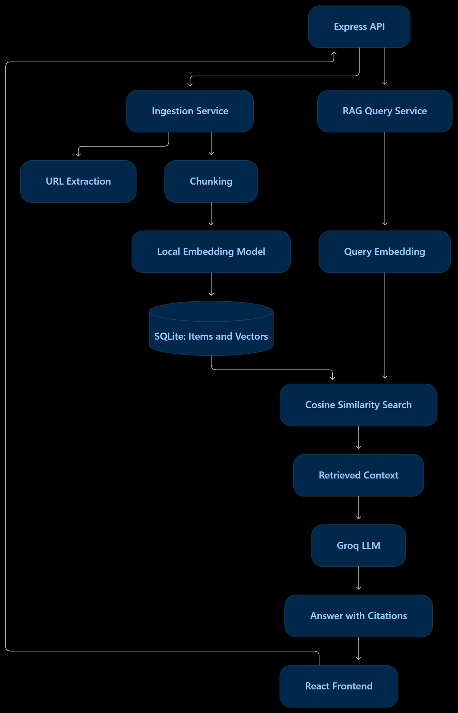

# Knowledge Inbox

Knowledge Inbox is a small, single-user workspace for keeping short notes and useful web pages. Save information once, then ask questions in natural language and get an answer with the saved excerpts it came from.

The project is intentionally compact: a React and Tailwind client, an Express API, SQLite for persistence, local sentence embeddings for retrieval, and Groq for answer generation.

## Features

- Save plain-text notes.
- Import public web pages by URL. The server extracts readable page text and stores the page title and final URL.
- Browse, filter, and search saved items in the library.
- Ask a question over saved content and see the answer with source identifiers and supporting snippets.
- Keep data in a local SQLite database between restarts.
- Use a responsive layout that works on phone, tablet, and desktop widths.

## Stack

| Area | Technology |
| --- | --- |
| Client | React, Vite, Tailwind CSS 4, Lucide icons, Axios |
| API | Node.js, Express, Zod, Helmet, CORS, Pino HTTP |
| Persistence | SQLite via `better-sqlite3` |
| Embeddings | `@huggingface/transformers`, `sentence-transformers/all-MiniLM-L6-v2` |
| Answer model | Groq API via `groq-sdk` |
| URL extraction | Cheerio |

## Project layout

```text
client/
  src/
    components/       UI sections for adding, browsing, and asking
    services/api.js   HTTP client and API helpers
    App.jsx           Page layout and shared UI state
    index.css         Tailwind import and global defaults
  vite.config.js      React and Tailwind Vite plugins
server/
  config/             SQLite and Groq setup
  controllers/        HTTP request handlers
  middlewares/        Request validation and error handling
  repositories/       SQLite item queries
  routes/             /api/ingest, /api/items, and /api/query
  services/           Extraction, chunking, embeddings, retrieval, and RAG
  data/               Local SQLite database (created automatically)
```

## Architecture



## Requirements

- Node.js compatible with the installed Vite release (Node 20.19+ or 22.12+ recommended).
- npm.
- A Groq API key for question answering. Notes and URL ingestion work without asking the model, but queries need the key.


## Setup

Install dependencies in both folders:

```powershell
cd server
npm install

cd ..\client
npm install
```

Create `server/.env` from `server/.env.example`, then add your Groq key:

```env
PORT=5000
CLIENT_URL=http://localhost:5173
GROQ_API_KEY=your_groq_api_key
GROQ_MODEL=openai/gpt-oss-120b
```

The server reads `GROQ_API_KEY` in `server/config/groq.js` and `GROQ_MODEL` in `server/services/llm.js`. Keep the real `.env` file private; it is excluded from Git.

The client defaults to `http://localhost:5000/api`. To use a different API origin, create `client/.env`:

```env
VITE_API_URL=http://localhost:5000/api
```

Run the API and client in separate terminals:

```powershell
cd server
npm run dev
```

```powershell
cd client
npm run dev
```

Open the Vite URL printed in the client terminal, normally `http://localhost:5173`.

For a production client build:

```powershell
cd client
npm run build
npm run preview
```

## How it works

1. **Ingestion:** The client sends a note or URL to `POST /api/ingest`. URL pages are fetched by the server and parsed to readable text. The content is split into overlapping chunks.
2. **Embedding and storage:** Each chunk is embedded with the local MiniLM model. The original item and chunk vectors are stored in SQLite together so a failed save cannot leave a partial item.
3. **Retrieval:** For a question, the same embedding model creates a query vector. The server compares it with stored chunk vectors using cosine similarity and selects the top five matches.
4. **Answering:** The selected excerpts and question are sent to the configured Groq chat model. The prompt asks it to answer from the excerpts and cite source identifiers such as `[S1]`.
5. **Presentation:** The client displays the answer, source title, snippet, and link when one is available.

The vector search is intentionally implemented as a scan over stored SQLite vectors. That keeps this prototype easy to run and inspect, while making retrieval work proportional to the number of chunks.

## API reference

All endpoints are prefixed with `/api`. Successful responses use `{ "success": true, "data": ... }`; errors use `{ "success": false, "message": "..." }`.

### `GET /api/health`

Returns a small status response to confirm that the API process is available.

### `POST /api/ingest`

Save either a note or a URL. Send one source type at a time.

Note request:

```json
{ "type": "note", "content": "Follow up with the design team on the new onboarding flow." }
```

URL request:

```json
{ "type": "url", "url": "https://example.com/article" }
```

Returns the saved item metadata, including its ID, type, title, status, chunk count, and creation time.

### `GET /api/items?page=1&limit=20`

Returns the newest items and pagination metadata. The API accepts a page size up to 100. Each item includes its type, title, source URL (when applicable), status, creation time, and chunk count.

### `POST /api/query`

Ask a question about saved content:

```json
{ "question": "What did I save about the onboarding flow?" }
```

The `data` object contains the question, answer, source count, and matching sources. A source includes a source ID, title, type, optional URL, snippet, and similarity score.

## Configuration

| Variable | Location | Default | Purpose |
| --- | --- | --- | --- |
| `PORT` | `server/.env` | `5000` | Express listening port |
| `CLIENT_URL` | `server/.env` | `http://localhost:5173` | Allowed browser origin for CORS |
| `GROQ_API_KEY` | `server/.env` | — | Required for answer generation |
| `GROQ_MODEL` | `server/.env` | Set a model supported by your Groq account | Chat completion model |
| `VITE_API_URL` | `client/.env` | `http://localhost:5000/api` | Client API base URL |

The SQLite file is created at `server/data/knowledge.db`. The embedding model is cached by Transformers.js outside the project.

## Tradeoffs and next steps

- **Local vector scan:** Simple and dependency-light for a small personal inbox. For a much larger library, move vectors to a database with an approximate-nearest-neighbor index.
- **Local embedding model:** Avoids a paid embedding API and stores vectors beside their chunks. The first model download adds startup/request latency; a production deployment should warm the model at startup and monitor memory use.
- **Single-user storage:** There is no authentication or per-user data partitioning. Add both before exposing the service to multiple users.
- **URL extraction:** HTML parsing handles ordinary article pages, not every site layout or JavaScript-rendered page. Keep outbound fetching restricted to public HTTP/HTTPS destinations.
- **LLM grounding:** The prompt requests citations and limits answers to retrieved context, but model output can still be wrong. Keep source excerpts visible so answers can be checked.
- **Operational hardening:** Add structured request IDs, request timeouts and retry policies for model calls, database backups, deletion/editing, and usage limits before a public deployment.

## Troubleshooting

- **Client cannot connect:** Check that the server is listening on port 5000 and that `VITE_API_URL` ends with `/api`.
- **CORS error:** Set `CLIENT_URL` to the exact origin shown by Vite, including its port, and restart the server.
- **Question fails but saving works:** Check that `GROQ_API_KEY` is set and that `GROQ_MODEL` is available to that key.
- **First question is slow:** The sentence embedding model may still be downloading or initializing.
- **A page will not import:** The server only accepts public HTTP/HTTPS HTML pages with extractable text; pages requiring a login or client-side rendering may not work.

